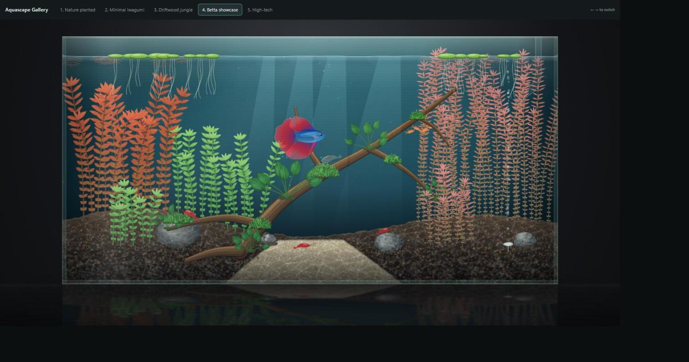
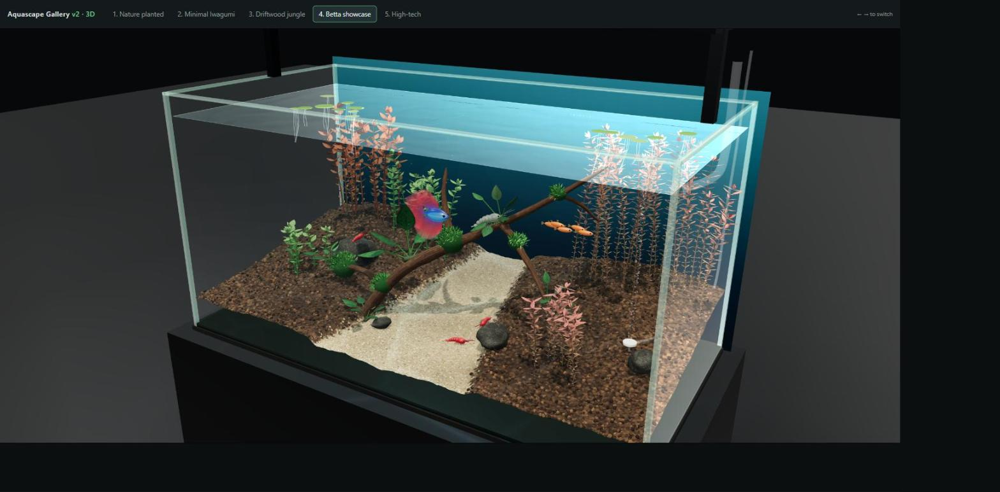
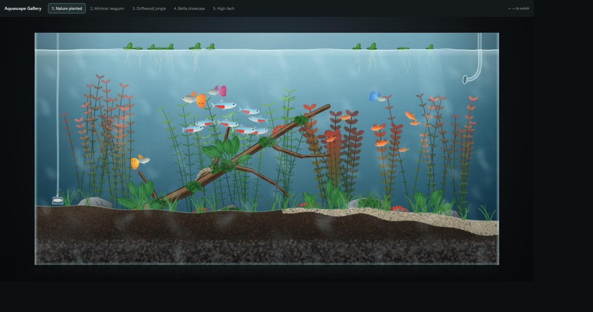
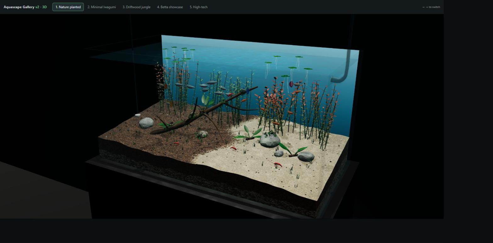
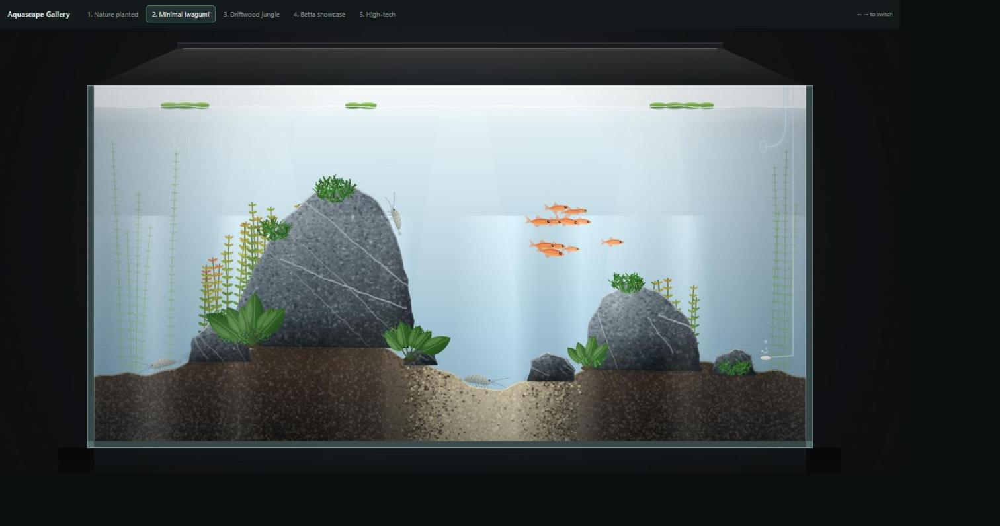
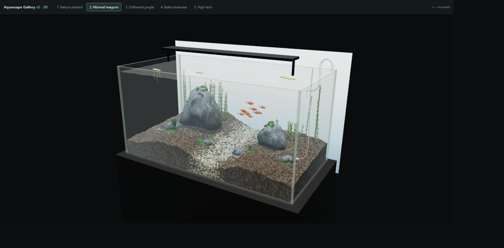
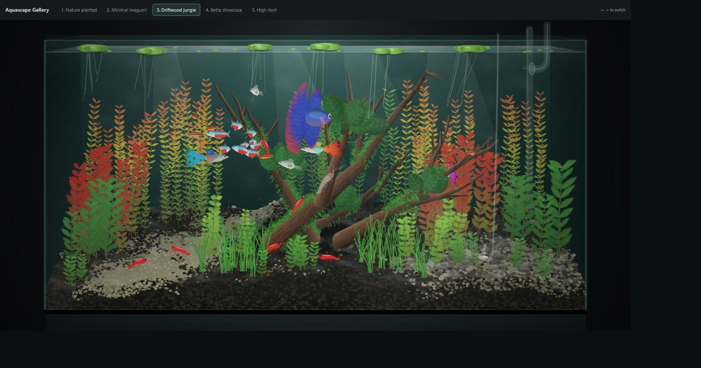
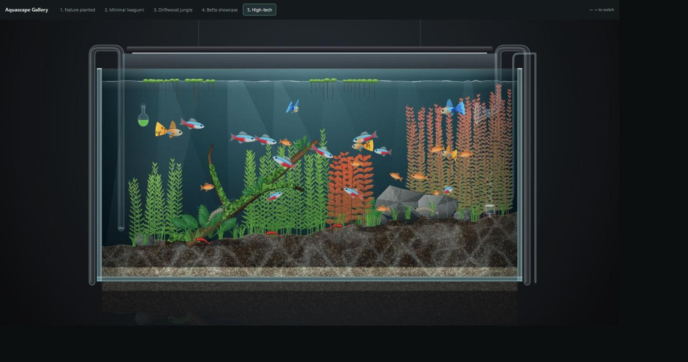

# Fable 5.1 Aquascape Gallery

Freshwater planted-aquarium scenes generated entirely by **Claude Fable 5.1** (`claude-fable-5-1`), as a first hands-on test of the model. Aquascaping is my hobby, so I gave it art-direction briefs for five tank styles and asked it to build each one as a single self-contained web page. There are no image models, stock assets or textures: every plant, fish, rock and bubble is drawn by code the model wrote.

The project went through two versions:

- **v1 (2D):** five animated, front-on aquarium scenes drawn on an HTML canvas.
- **v2 (3D):** the same layouts rebuilt in three.js from one "realism and perspective upgrade" brief, with a three-quarter camera, visible glass, substrate depth and gentle animated motion.

## Gallery

### v1 vs v2: same layout, 2D to 3D

v2 was told to *keep* each v1 layout (plants, fish, hardscape and equipment) and change only the realism and the camera angle.

| v1 · 2D | v2 · 3D |
|---|---|
|  |  |
| **Betta showcase:** a single betta over a driftwood branch, red rotala and cherry shrimp on a sand path | Same layout in a rimless glass tank on a cabinet |
|  |  |
| **Nature planted:** a diagonal driftwood branch, stem plants, neon tetras and guppies | The split aquasoil/sand substrate becomes visible in 3D |
|  |  |
| **Minimal Iwagumi:** a stone-led layout with a main rock, a school of small tetras and Amano shrimp | The rocks, sloped substrate and light bar seen in perspective |

### More v1 scenes

| Driftwood jungle | High-tech |
|---|---|
|  |  |
| A dense tangle of branches with red and green stem plants, a betta, tetras and shrimp | A CO2-injected planted tank with lily pipes, a drop checker and a diffuser |

> The Driftwood jungle and High-tech scenes have no v2 version yet. Both runs hit the 128K output-token limit before finishing (the partial outputs are in `aquariums-v2/scenes/history/`).

## Run it locally

The scenes are plain HTML and need no build step. v2 loads three.js as an ES module, which browsers block over `file://`, so serve the folder over HTTP:

```bash
python -m http.server 8000
```

Then open:

- v1: http://localhost:8000/aquariums/
- v2: http://localhost:8000/aquariums-v2/

Use the tabs or the ← → keys to switch tanks.

## Regenerate the scenes

```bash
python -m venv .venv
.venv/Scripts/pip install -r requirements.txt     # Windows; use .venv/bin/ on macOS/Linux
echo ANTHROPIC_API_KEY=your-key-here > .env       # gitignored, never committed

.venv/Scripts/python aquariums/generate.py              # all five v1 scenes
.venv/Scripts/python aquariums/generate.py 2-iwagumi    # just one
.venv/Scripts/python aquariums-v2/generate.py 4-betta-showcase --effort high
```

`demo.py` is a small streaming chat client for Fable 5.1, used to try out the model before the gallery.

## How it was made

| | v1 | v2 |
|---|---|---|
| Input | One art-direction brief per tank (`aquariums/prompts/`) | One shared upgrade brief (`aquariums-v2/prompts/upgrade-brief.txt`) plus a screenshot of the matching v1 scene (`aquariums-v2/reference/`) |
| Output | Canvas 2D, single HTML file per scene | three.js (vendored in `aquariums-v2/vendor/`), single HTML file per scene |
| Settings | `effort: high`, streaming | `effort: high`, `max_tokens: 128000`, streaming |
| Result | 5 of 5 scenes completed | 3 of 5 completed; 2 hit the output cap |
| Est. cost | ~$22.09 | ~$32.74 |

The total was **roughly $55** in API usage. The costs are estimates from token counts in the `generate.log` files. A v2 re-run that dropped its connection partway through isn't included.

## Repo layout

```
aquariums/        v1: prompts, generator, 5 scenes, gallery index.html
aquariums-v2/     v2: upgrade brief, v1 reference shots, generator, 3D scenes, vendored three.js
screenshots/      captures used in this README
demo.py           streaming chat client for claude-fable-5-1
```
